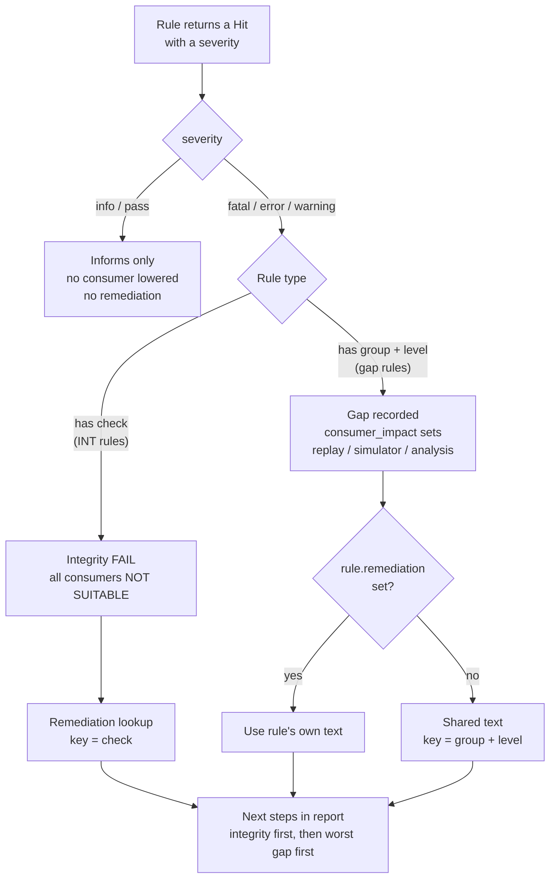

# How a Rule Becomes a Verdict and a Next Step

This page explains how one rule in `rules.toml` turns into two outputs:

- a **verdict** per consumer (replay, simulator, analysis), shown in the CLI output and the report
- a **next step** that tells the reader how to fix the trace, shown in the report only

## The big picture

- The linter reads a Chakra trace and runs a set of rules against it.
- Each rule that finds a problem returns a **Hit**, which carries a severity.
- The severity decides whether the Hit matters.
- The rule's fields in `rules.toml` decide what effect the Hit has on each consumer and which fix the report suggests.

## Flowchart

## Step by step

### 1. Severity: does the Hit matter?

- Severity is one of `fatal`, `error`, `warning`, `info`, `pass`.
- `info` and `pass` only report a fact. They lower no consumer and add no next step.
- `fatal` stops the scan, because nothing further can be trusted.
- `error` and `warning` continue to step 2.

### 2. Rule type: what kind of problem is it?

Every rule is one of two types. A rule never mixes them.

- **Integrity defect** (rule has `check`)
  - The trace is broken or unreadable.
  - Checks: `DECODE`, `CONTENT`, `SCHEMA`, `DAG`.
  - Result: integrity FAIL and every consumer becomes NOT SUITABLE.
- **Gap** (rule has `group` and `level`)
  - The trace is readable but lacks some evidence.
  - Result: the rule's own `consumer_impact` line sets an impact value per consumer.

### 3. Consumer impact: what does the problem cost each consumer?

- Each rule declares one `consumer_impact` line in `rules.toml`.
- The line holds one impact value per consumer: replay, simulator, and analysis.
- A consumer left off the line, or set to `READY`, takes no effect from that rule.
- Impact values, from best to worst:
  - `READY`: no effect.
  - `LIMITED`: a known gap lowers fidelity, the consumer still works.
  - `REVIEW`: the linter cannot decide, a person must inspect.
  - `NOT SUITABLE`: the consumer cannot use the trace.
- When several rules hit, each consumer takes the worst impact value among them.

### 4. Group and level: how is the gap labeled?

- **Group** names the area of evidence that the gap affects.
  - `TIMING`, `KINETO`, `COMM`, `OP_SCHEMA`, `IO`, `META`, `ATTR`.
- **Level** names how degraded that area is.
  - Examples: `PARTIAL`, `ABSENT`, `INCOMPLETE`, `UNLINKED`, `NONE`.
- Together, group and level form a label such as `TIMING` + `ABSENT`.
- This label does not change any verdict. Its only job is to select a next step.

### 5. Remediation: what should the reader do?

- The report looks up the next step in this order:
  - The rule's own `remediation` text, if present.
  - Otherwise the shared text for its `group` + `level`.
  - For an integrity defect, the shared text for its `check`.
- Shared texts live in the `[[remediation]]` entries of `rules.toml`.
- A gap rule with no resolvable text fails when the file loads.
- The report lists integrity fixes first, then gap fixes from worst to least severe.
- Next steps appear only in the markdown and HTML report, under "Next steps" ([reports.py:253-255](reports.py#L253-L255)).
- The CLI output never shows them.

## Consumer impact versus group level

The two fields are unrelated. Only `level` carries that name.

| Field | Values | Purpose |
| --- | --- | --- |
| `consumer_impact` | `READY`, `LIMITED`, `REVIEW`, `NOT SUITABLE` | The verdict. One value per consumer. |
| `level` (with `group`) | `PARTIAL`, `ABSENT`, `INCOMPLETE`, ... | A label on the gap. Selects the remediation. |

## Worked example: rule `TIM001`

- The linter finds that most nodes have zero duration.
- The `timing-absent` rule returns a Hit with severity `error`.
- Severity is not `info` or `pass`, so the Hit matters.
- The rule has `group = "TIMING"` and `level = "ABSENT"`, so it is a gap.
- Its `consumer_impact` sets:
  - replay: `READY`
  - simulator: `REVIEW`
  - analysis: `NOT SUITABLE`
- The rule has no `remediation` of its own.
- The report uses the shared text for `TIMING` + `ABSENT`: re-capture with the PyTorch profiler enabled.

## Observation

- The code reads `group` and `level` only in `Gap.from_hit` ([consumer.py:133-141](consumer.py#L133-L141)). They feed the remediation lookup and are stored on the gap.
- No report section groups or displays findings by group or level.
- `TraceResult.next_steps()` has one caller, the report writer. CLI users see findings and verdicts but no remediation.
- Consequence: the two fields act as a remediation key today. A future per-group evidence summary would be the first use beyond that.
