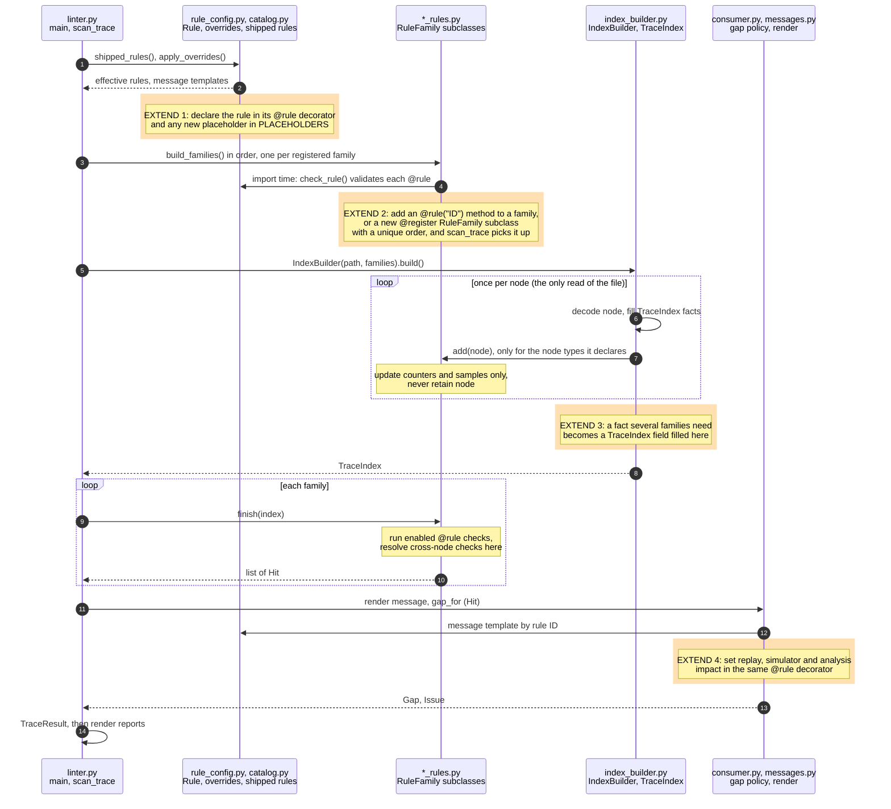

# The Chakra Linter

## Purpose

- Measure how usable each Chakra execution trace (`.et` file) is before teams rely on it.
- Grade usability per consumer, because a trace serves some uses fully and others partially or not at all.
- Detect defects automatically, without manual inspection in a UI.
- Give engineers a suitability verdict per consumer with a specific reason for each gap.

## Problem Statement

- Teams share Chakra traces without a standard check of what each trace supports.
- Trace quality varies with the producer, the conversion pipeline, and the capture method.
- Defects surface late, often as misleading results in a downstream tool.
- Consumers have no fast way to determine whether a trace fits their purpose.
- Trace authors receive no structured feedback on what to correct.

## Goals

- Provide a quick, standalone linter for Chakra traces.
- Scan a set of traces and report how usable each one is per consumer.
- Detect structural, semantic, and completeness defects.
- Provide specific evidence that helps trace authors and consumers resolve gaps.
- Serve as a quality gate for tools that require well-formed traces, such as replay.

## Position in the Toolchain

- The linter reads `.et` files only. It runs standalone and needs no other Chakra tool.
- Standalone use: lint any `.et` file or directory, whatever produced it (converter, generator, or another tool).
- Pipeline use: it runs last, after conversion and before any consumer reads the traces.

| Stage   | Tool                | Input                          | Output                    |
|---------|---------------------|--------------------------------|---------------------------|
| Trace   | PyTorch profilers   | Workload run                   | Host trace, device trace  |
| Link    | `chakra_trace_link` | Host trace, device trace       | Merged host-device JSON   |
| Convert | `chakra_converter`  | Merged host-device JSON        | Chakra `.et` files        |
| Lint    | `chakra_linter`     | `.et` files or directories     | Usability report          |

Standalone example:

```bash
chakra_linter traces/ --report-output report.md
```

Pipeline example:

```bash
# 1. Trace: capture host and device traces per rank (PyTorch profilers)

# 2. Link: merge host and device traces
chakra_trace_link \
    --chakra-host-trace host_trace_0.json \
    --chakra-device-trace device_trace_0.json \
    --rank 0 \
    --output-file linked_0.json

# 3. Convert: encode the merged trace as protobuf
chakra_converter PyTorch --input linked_0.json --output traces/chakra.0.et

# 4. Lint: grade every trace in the directory per consumer
chakra_linter traces/ --report-output report.md
```

- In a pipeline, run the lint stage after every conversion to detect defects at the stage that introduced them.
- Use the report as a gate before replay, simulation, or analysis starts.
- Share the report with the trace so consumers see the supported uses.

## Methodology

- Usability is a degree, not a yes or no answer. Every trace receives one usability value per consumer.
- Each rule sets a value for each consumer it affects; the worst value wins.
- Rules for decode failure, empty traces, schema violations, and DAG validity set `NOT SUITABLE` for every consumer.
- Consumers (full definitions live in [`CONSUMER_INFO` in consumer.py](consumer.py); the report prints the same text):
  - **Replay:** re-executes operators; requires collective and point-to-point attributes, and replay units: the outermost CPU nodes (`is_cpu_op` true) that carry a non-empty `op_schema`, with I/O that fits it. Replay runs a unit with its whole subtree, so descendants are not graded. GPU kernels need no schema; replay runs the CPU operator that launches them. Durations may be zero, because replay runs the operator rather than modeling its time.
  - **Simulator:** models timing from the graph; requires communication attributes and a duration or I/O for each compute node.
  - **Analysis:** reads timing and structure; requires nonzero durations and a device link.
- Synthetic traces skip the timing and Kineto checks, so they favor simulator suitability. No separate flag applies.
- Example: a replay unit lacks `op_schema` but has a duration above zero. Replay cannot call it; simulator and analysis are `READY`.
- A replay unit with an `op_schema` and readable I/O that fits the schema is replayable, whatever its duration.

## Architecture

- One pass over the `.et` file feeds every rule family; no rule re-reads the file.
- Each rule's text, severity and consumer impact sit in the `@rule` decorator of its check in `*_rules.py`.
- Each module has one job:

| Module | Job |
|--------|-----|
| `linter.py` | Orchestrates the run: builds the families, collects hits, handles the CLI. |
| `*_rules.py` | One rule family each; fills accumulators and returns hits. |
| `index_builder.py` | Makes the single pass and holds the shared `TraceIndex`. |
| `consumer.py` | Grades gaps per consumer: evidence groups, gap levels, `TraceResult`; reads gap policy from the rule catalog. |
| `messages.py` | Fills message templates from the rule catalog. |
| `reports.py` | Renders markdown, HTML, stylish CLI, JSON, and SARIF output. |
| `rule_config.py` | Defines `Rule`, validates it, and applies `--set` overrides. |
| `catalog.py` | Imports every family and lists the shipped rules in report order. |

- A hit carries a severity: `fatal` stops the scan; `error`, `warning`, and `info` show the message; `pass` shows nothing. For suitability, `info` counts as `pass`: it lowers no consumer impact.
- Orange blocks in the diagram mark the steps where a developer extends the rules.

### Module Interaction

- Participants are modules; arrows follow one lint run in order.
- Orange blocks mark where a developer extends the rules.



### Where to Extend

| Change                | Files to touch                                                                             |
|-----------------------|--------------------------------------------------------------------------------------------|
| Reword or re-grade rule | Its `@rule(...)` arguments in `*_rules.py`                                               |
| New placeholder       | `PLACEHOLDERS` in `rule_config.py`, before use in a message                                |
| New rule, existing family | `@rule("ID", ...)` method in `*_rules.py` with name, severity, message, description and impact |
| New family            | New `*_rules.py` with `@register` subclass; import it and add its ID prefix in `catalog.py` |
| New shared fact       | Field on `TraceIndex`, filled in `IndexBuilder`; never a per-family node copy              |

- `add` runs once per node; keep only counters, samples, and scalars.
- `finish` runs once after the pass; resolve cross-node checks there.
- A family never retains `node`.

## Rule Configuration

- Every rule is declared once, in the `@rule` decorator of the check that implements it.
- `catalog.py` imports every family and lists the shipped rules in report order.
- A user changes a rule for one run with `--set`; no rule file exists.

### The `@rule` Decorator

```python
@rule(
    ABC001,
    name="abc-example",
    severity=ERROR,
    message="{count} nodes have the defect",
    description="What the rule checks and why it matters.",
    replay=NOT_SUITABLE,
    analysis=REVIEW,
)
def example(self, index: TraceIndex) -> list[Hit]: ...
```

| Argument      | Required | Constraint                                                          |
|---------------|----------|---------------------------------------------------------------------|
| ID (positional) | Yes    | Two or three capital letters plus three digits, such as `ABC001`.   |
| `name`        | Yes      | Kebab-case label, unique across rules.                              |
| `severity`    | Yes      | `fatal`, `error`, `warning`, `info`, or `pass`. One fixed value; a case that differs is a separate rule. |
| `message`     | Yes      | Report text. `{placeholders}` must appear in `PLACEHOLDERS`.        |
| `description` | Yes      | What the rule checks and why it matters. Ends with a period.        |
| `replay`, `simulator`, `analysis` | No | `READY` (default, no effect), `LIMITED` (known gap lowers fidelity), `REVIEW` (linter cannot decide) or `NOT_SUITABLE` (consumer cannot use the trace). Applies when a finding reports at `warning` or above. |
| `enabled`     | No       | Default `True`; `False` drops the rule's findings before grading.   |
| `required`    | No       | `True` for rules that cannot be disabled or re-graded. |
| `exempt`      | No       | Shell-style name patterns exempt from the check.                    |

- The ID prefix groups rules by area. `chakra_linter --list-rules` shows every rule.
- IDs stay stable and are never reused for a different rule.
- A class constant such as `ABC001 = "ABC001"` names the ID once for the decorator and for `Hit`.

### Source of Truth

- Rule family modules (`*_rules.py`) own detection and the rule declarations. Each family class fills accumulators during the single pass over the trace, and its `@rule` methods turn them into findings.
- `PLACEHOLDERS` in `rule_config.py` is the master list of placeholder names, each with a description.
- `CONSUMER_INFO` in `consumer.py` holds one suitability entry per consumer: its ID, name and text.
- Each rule has one severity and one impact per consumer. A check never overrides either. A case that differs is a separate rule.
- `scan_trace` resolves each hit's severity from the effective rules, so `--set` severity changes reach grading.

| Concern                   | Defined in                      |
|---------------------------|---------------------------------|
| Rule ID, name, wording    | `@rule` in `*_rules.py`         |
| Severity and consumer impact | `@rule` in `*_rules.py`      |
| Enabled by default        | `@rule(enabled=...)`            |
| Exempt annotation names   | `exempt=` on the rule that uses them |
| Detection logic           | `*_rules.py` (one family per category) |
| Placeholder names, meaning | `PLACEHOLDERS` in `rule_config.py` |
| Report order of families  | `GROUP_ORDER` in `catalog.py`   |

### Traceability

One rule ID links a Hit to its outputs.

- `rule ID`: joins the Hit to its `@rule` declaration.
- Consumer impact: joins the rule to the verdict, one value per consumer.
- Values, best to worst: `READY`, `LIMITED`, `REVIEW`, `NOT SUITABLE`.
- `info` and `pass` Hits lower no consumer. `fatal` stops the scan.
- `TraceResult.status` takes the worst value per consumer across all findings.
- The CLI and the report show the same rows: findings, then one suitability row per consumer.

### Validation

- Import time: each `@rule` is validated when its family class is created. A bad ID, name, severity, impact value, description or message placeholder raises `TypeError`, and the linter does not start.
- Registration: `@register` rejects a reused rule ID or name.
- Catalog: `catalog.py` rejects an ID prefix that `GROUP_ORDER` omits.
- Command line: `--set` and `--set-file` entries are validated before any trace scan.
- `tests/linter/test_rule_catalog.py` enforces the criteria that the decorator cannot express:
  - IDs and names are unique.
  - Prefix groups are contiguous and numbered from 001.
  - Placeholders match what each check supplies.
  - `exempt` belongs to one rule only.
  - Required rules are exactly the fatal ones.
- `tests/linter/test_rule_inventory.py` confirms that the catalog and the CLI agree.
- `tests/linter/test_rule_overrides.py` covers the override syntax and its errors.

### Usage

- `--list-rules` prints every rule with its severity and enabled state, as overridden for the run, then exits. A trailing `(set: ...)` names each field that differs from the shipped default.
- `--set SELECTOR.FIELD=VALUE` overrides one field for one run; it repeats.
  - `SELECTOR` is a rule ID, name, or prefix, such as `DAG`.
  - `FIELD` is `enabled`, `severity`, `message`, `exempt` (comma-separated patterns), or `consumer_impact.replay`, `consumer_impact.simulator`, `consumer_impact.analysis`.
  - A required rule rejects `enabled` and `severity` changes.
- `--set-file FILE` reads the same settings from a file, one per line. Blank lines and lines that start with `#` are skipped. `--set` entries apply after the file and win.
- `--enable-rule` and `--disable-rule` remain as short forms of `enabled`. Each accepts a rule ID, name, or prefix, and repeats.
- Example: disable one rule and downgrade another for a run.

```bash
chakra_linter traces/ --disable-rule KIN001 --set STO007.severity=info
```

### Changing a Rule

- Edit wording, severity, impact, or default state in the rule's `@rule(...)` call. The change and the check sit in one diff.
- Add a rule by adding a `@rule("ID", ...)` method on its family in `*_rules.py`. Add any new placeholder to `PLACEHOLDERS` first.
- Add a family by subclassing `RuleFamily`, decorating it with `@register`, and setting a unique `order`. `scan_trace` builds every registered family in `order`.
- Import the new `*_rules.py` module in `catalog.py` and add its ID prefix to `GROUP_ORDER`. A test fails when a module registers no family.
- Override `create` only when the family needs more than `disabled`, as `ReplayRules` does.
- Retire a rule by leaving its ID unused. Do not reassign the ID.
- Run the linter tests after every change.

## Backlog

### Linter: Rule Metadata Concepts

The linter dropped four concepts because the project never defined them.

- Each concept needs a definition, an owner, and an output that uses it before reintroduction.
- The removed implementation lived in `src/linter` (`rules.toml`, `rules.schema.json`, `rule_config.py`, `consumer.py`, `reports.py`).

#### Group

- **Intent:** assign each rule to an evidence area: `TIMING`, `KINETO`, `COMM`, `OP_SCHEMA`, `IO`, `META`, `ATTR`.
- **Gap:** no report section grouped findings by it; the rule ID prefix already groups rules.
- **Open question:** define how groups differ from the rule ID prefixes.

#### Level

- **Intent:** label how far a group falls short, such as `ABSENT`, `PARTIAL`, `UNLINKED`, `INCOMPLETE`, `NONE`.
- **Gap:** the label did not feed any verdict. `consumer_impact` already sets the verdict.
- **Open question:** define a closed vocabulary and the rule that picks the worst level per group.

#### Check

- **Intent:** mark an integrity defect (`DECODE`, `CONTENT`, `SCHEMA`, `DAG`) and report a trace-wide integrity result of `PASS` or `FAIL`.
- **Gap:** the CLI never showed integrity. Integrity rules already set `NOT SUITABLE` for every consumer.
- **Open question:** decide whether integrity is a separate verdict or only a rule family.

#### Remediation

- **Intent:** attach a next step to each finding, shared per group and level or overridden per rule.
- **Gap:** only the report printed next steps; the CLI never did, and the text was written without review.
- **Open question:** define the audience, the wording standard, and whether the CLI shows it.
